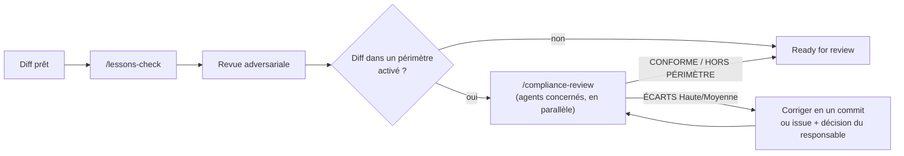

# Conformité : relecteurs spécialisés

Fondation pour ajouter des exigences de conformité à la boucle de revue sans alourdir chaque PR. Un relecteur de
conformité est un **sous-agent en lecture seule**, lancé seulement quand le diff touche son périmètre. Il produit des
**hypothèses d'écart** sourcées, jamais une certification, un audit ou un avis juridique : le DPO, le RSSI, le QSA ou
l'auditeur tranche.

## 1. Catalogue

| Agent | Référentiel | Déclencheurs typiques dans un diff | Qui confirme |
|---|---|---|---|
| `compliance-gdpr` | RGPD (UE) 2016/679 | données personnelles, consentement, conservation, transfert hors UE, logs | DPO |
| `compliance-eu-ai-act` | AI Act (UE) 2024/1689 | appel de modèle, contenu généré, scoring, biométrie | Référent IA, juriste |
| `compliance-nis2` | Directive (UE) 2022/2555 | gestion d'incident, journalisation, chaîne d'approvisionnement, chiffrement | RSSI |
| `compliance-iso27001` | ISO/IEC 27001:2022 (annexe A) | contrôle d'accès, journalisation, développement sécurisé, fournisseurs | RSSI, auditeur |
| `compliance-soc2` | AICPA TSC 2017 (points of focus 2022) | gestion des changements, accès logiques, surveillance | Auditeur SOC 2 |
| `compliance-tisax` | ENX TISAX / VDA ISA | protection des prototypes, données de constructeur, accès | Responsable TISAX |
| `compliance-pci` | PCI DSS v4.0.1, PCI PIN, PCI P2PE | PAN, CVV, page de paiement, scripts tiers, clés, HSM, terminal | QSA |
| `compliance-hds` | Hébergement de données de santé (CSP L.1111-8, référentiel HDS) | données de santé, hébergeur, sauvegardes, localisation | Responsable HDS |

Agents intégrés : `plugins/harness/agents/compliance-*.md` (vendorisés en `.claude/agents/`), plus le relecteur
générique `compliance-reviewer` pour les specs du projet (§2). Chaque agent porte ses
déclencheurs, sa liste de vérification (exigence → source), les preuves attendues dans le dépôt et un format de
réponse fixe. Les identifiants non vérifiés sur le texte officiel sont marqués « (à vérifier) » ; les sources
indiquent leur date de consultation. **Les référentiels évoluent** (versions, actes modificatifs, transpositions) :
la revue annuelle d'un agent est une issue du cadre.

## 2. Brancher un référentiel : trois modes

Le cadre fournit des agents, il ne les impose pas. Chaque entreprise choisit, référentiel par référentiel :

| Mode | Quand | Déclaration dans `.harness/config.json` → `compliance` | Ce qui tourne |
|---|---|---|---|
| **Intégré** | Le référentiel est au catalogue (§1) et l'agent du cadre convient | `"gdpr"` | `compliance-gdpr` du cadre |
| **Agent de l'entreprise** | L'entreprise a déjà son relecteur (prompts internes, contrôles maison, outillage QSA) | `{"id": "pci", "agent": ".claude/agents/acme-pci.md"}` | Son agent, à la place de l'intégré |
| **Spec seule** | L'entreprise veut juste décrire ses exigences (référentiel absent du catalogue, ou politique interne) | `{"id": "dora", "spec": "docs/compliance/dora.md"}` | Le relecteur générique `compliance-reviewer`, qui applique la spec et rien d'autre |

Options communes à chaque entrée :
- `"paths"` (globs : `*` et `?` restent dans un dossier, `**/` couvre zéro ou plusieurs dossiers, `src/**` tout le
  dessous) et `"keywords"` (mots entiers, sans casse, cherchés dans les lignes ajoutées ou retirées du diff, hors
  en-têtes de fichier) : le périmètre se décide **sans lancer d'agent** (aucun jeton dépensé pour un diff hors périmètre) ; sans eux, l'agent en juge ;
- `"confirme"` : qui tranche (DPO, RSSI, QSA) ; `"enabled": false` : désactive sans supprimer.

Exemple complet :
```json
{
  "compliance": [
    "gdpr",
    { "id": "pci", "agent": ".claude/agents/acme-pci-qsa.md", "paths": ["src/paiement/**"], "confirme": "QSA ACME" },
    { "id": "dora", "spec": "docs/compliance/dora.md", "keywords": ["incident", "ict"], "confirme": "RSSI" },
    { "id": "iso27001", "enabled": false }
  ],
  "exclude": [".claude/agents/compliance-tisax.md", ".claude/agents/compliance-hds.md"]
}
```

- **Résolution** déterministe : `.harness/scripts/compliance-plan.py --base origin/<intégration>` (appelé par
  `/compliance-review`) dit, pour chaque entrée, quel agent tourne, sur quel fichier, et si le diff est dans son
  périmètre ; une entrée invalide (agent introuvable, spec incomplète, id inconnu, doublon) fait échouer le plan.
- **Spec** : gabarit `docs/compliance/TEMPLATE.md` (créé à l'adoption, appartient au projet) : en-tête `id`,
  `référentiel`, `confirme`, puis « Quand intervenir », « Ce que je vérifie », « Preuves attendues », « Sources ».
  Le relecteur générique ne cite que ce que la spec cite ; une lacune de la spec est signalée, pas inventée.
- **Agent de l'entreprise** : un fichier d'agent (adaptateur Claude Code : en-tête `name`, `description`, `tools`, `model`) dans
  le dépôt ; le cadre ne le synchronise jamais. Garder le format de réponse du §3 pour que les verdicts se
  consolident ; le mettre en lecture seule.
- Un label `conformité: <id>` sur une issue force la revue correspondante, même hors périmètre. Ces labels sont
  propres au projet (`.github/labels.local.json` ; le cadre ne fournit que `conformité`).

## 3. Place dans la boucle



- Les verdicts vont dans la PR (section « Conformité ») : agent, verdict, tête relue, constats ouverts.
- Un écart que l'équipe accepte (risque assumé) se trace dans un ADR signé par le responsable, jamais en silence.
- Une faille de sécurité ne se détaille jamais publiquement.

## 4. Ajouter un référentiel
1. Issue sur le cadre (type `feature`, label `conformité`), avec les sources officielles.
2. Copier un agent existant, garder ses sections ; ne citer que des identifiants vérifiés sur le texte officiel.
3. Ajouter la ligne au §1 ; MINEUR au CHANGELOG. Un référentiel propre à une entreprise ne vient pas au cadre : il
   reste une spec ou un agent du projet (§2).
