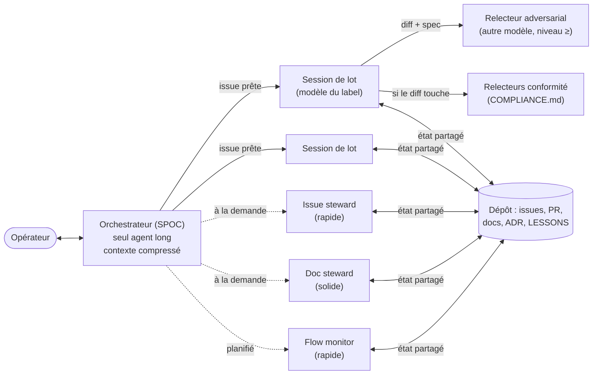

# FinOps agentique : orchestrateur, routage des modèles, quotas, dérives

Comment dépenser les jetons et les minutes de CI là où ils produisent de la valeur. Complète
[ORCHESTRATION](ORCHESTRATION.md) (qui fait quoi) et [CI-BUDGET](CI-BUDGET.md) (minutes de CI). Tableau de bord :
`flow-metrics.py` / `flow-report.yml` (§4).

## 1. Topologie : un seul agent long, des agents jetables

- **L'orchestrateur est le point de contact unique (SPOC)** de l'opérateur et le **seul** agent à longue durée de vie.
  Il ne code pas : il route, suit, relance, rend compte. Son contexte est **compressé** (résumés, liens vers l'état) et
  il tourne sur un modèle solide, pas forcément le plus cher : router demande du jugement, pas de la génération.
- **Le contexte vit dans le dépôt, pas dans l'agent.** Ce qu'un agent doit savoir pour reprendre (plan, décisions,
  avancement, blocages) est dans une issue, une PR, un ADR, `LESSONS.md` ou une spec de lot. Un agent qu'on tue ne
  perd donc rien ; un agent qu'on lance lit l'état et repart. Corollaire : toute connaissance acquise en session qui
  vaut au-delà d'elle est écrite **avant** la fin de session (sinon elle est perdue et sera repayée).
- **Les stewards et les relecteurs sont jetables** : lancés pour une tâche, tués après, relancés au besoin
  ([STEWARDS](STEWARDS.md)). Un contexte frais coûte moins cher qu'un contexte long qui traîne ses vieux tours et dérive.
- **Éviter le contexte froid** : un agent relancé ne relit pas tout le dépôt. Son prompt lui donne exactement les
  fichiers et issues utiles (le brief, ORCHESTRATION §4) ; les docs restent courts et structurés pour être lus vite
  (ESSENTIEL.md d'abord, le détail sur demande).

## 2. Routage des modèles : ni sur- ni sous-affectation

| Travail | Niveau | Pourquoi |
|---|---|---|
| Tri d'issues, labels, hygiène de docs, rapport d'état, contrôle de conventions | rapide (Haiku) | Règles explicites, sortie vérifiable |
| Lot bien spécifié, plusieurs fichiers, CI, tests | solide (Sonnet) | Le gros du volume : le meilleur rapport qualité / coût |
| Moteur, sécurité, réglementaire, architecture, flux qui écrivent | frontière (Opus) | Une erreur coûte plus qu'un jeton |
| **Revue** d'un lot solide ou frontière | niveau ≥ auteur, **autre modèle** | Relire coûte beaucoup moins que coder : y mettre le meilleur modèle est le placement le plus rentable |
| Décision structurante, ADR difficile | Fable / frontière + revue | Rare, à fort effet de levier |

Règles :
1. **La valeur du label `modèle:` fait foi** (ORCHESTRATION §2). Sous-affecter (Haiku sur une règle financière) coûte
   des cycles de revue et des bugs ; sur-affecter (Opus sur un renommage) coûte des jetons sans gain mesurable.
2. **Déléguer tôt** : dès qu'une tâche se découpe (y compris la planification initiale, la recherche, la lecture d'un
   gros fichier), un sous-agent du bon niveau la prend ; l'agent principal garde la conclusion, pas les fichiers lus.
   Ne pas déléguer ce qui tient en quelques appels d'outils (le brief coûterait plus que le travail).
3. **Un modèle plus fort relit, un modèle adapté écrit.** Mesurer : si un niveau rapide demande plus de deux cycles de
   revue sur un type de tâche, remonter le label de ce type ; si un niveau frontière ne trouve jamais rien à corriger
   chez un auteur solide, la revue peut descendre d'un cran sur ce type.

## 3. Quotas, parallélisme et reprise

- **Le parallélisme est borné par le système, pas par le calendrier** : runners CI simultanés, PR ouvertes par
  contributeur, sessions autorisées, fichiers partagés (on sérialise ce qui touche les mêmes fichiers), capacité de
  relecture de l'opérateur. Dans ces bornes, on lance tout ce qui est prêt.
- **Pas de rétention par biais de quota** : retarder une livraison pour « finir le quota » le dernier jour avant la
  remise à zéro, ou à l'inverse étaler pour « garder du quota », est un biais humain, pas de l'efficience. Le quota est
  une contrainte d'ordonnancement : on livre dès que c'est prêt, on priorise (sécurité, P1, chemin critique) quand il
  se raréfie.
- **Quota atteint (jetons ou minutes)** : l'orchestrateur écrit l'état sur chaque issue en cours (« Passation : … »),
  programme sa reprise à l'heure de remise à zéro (ex. Claude Code : `send_later` ; ou tâche planifiée, jamais une boucle d'attente) et
  s'arrête proprement. À la reprise : relire l'état du dépôt (L18, L19), pas sa mémoire.
- **Minutes de CI épuisées** : contrôles locaux avant chaque merge (`local-check.sh` qui dit « INCOMPLET » s'il manque
  un outil), CI-BUDGET §2.
- **Boucles bornées** (d'après la boucle de réparation d'OpenHarness, [`autopilot/service.py`](https://github.com/HKUDS/OpenHarness/blob/main/src/openharness/autopilot/service.py), `repair max_rounds`, lu le 2026-11-07) :
  au plus **3 cycles de revue** et **6 pushes testés par la CI** par PR ; au-delà, l'orchestrateur arrête l'auteur, écrit le
  diagnostic sur l'issue et réaffecte (modèle au-dessus, spec à clarifier, ou humain).

## 4. Surveiller les dérives

Le tableau de bord (`flow-report.yml`, script `flow-metrics.py`) calcule chaque jour, depuis l'API GitHub :

| Signal | Seuil par défaut | Lecture | Action |
|---|---|---|---|
| Issue prise en charge (`/claim`, label `pris en charge`) sans activité | 24 h | Session morte ou bloquée en silence | Watchdog : arrêter, noter l'état, rendre l'issue |
| PR prête sans activité / brouillon | 24 h / 120 h | Revue ou auteur en panne | Relancer le bon acteur |
| Pushes testés par la CI sur une PR (SHA distincts, runs sautés ou annulés exclus) | > 6 | Boucle de push d'essai | Arrêt, diagnostic local, un commit par cycle |
| Revues sur une PR | > 3 | Boucle de revue (correctifs à l'instance, pas à la classe) | Contre-vérification, REVIEW-ROUNDS §3 |
| `bloqué`, `à clarifier` | tout | Goulot externe ou décision produit | Remonter à l'opérateur, avec la question exacte |
| Délai médian ouverture → merge | tendance | Fluidité | Comparer semaine à semaine |
| PR mergées agents / humains | tendance | Volume agentique | Calibrer CI et revue (CI-BUDGET §5) |
| Minutes facturées, taux d'échec CI | tendance | Surconsommation | Une hausse sans hausse du volume = dérive |
| **PR à problème** (≥ 1 constat en revue : adversariale, IA, conformité, CodeRabbit, humain), agents / humains | > 50 % dès 3 PR | Qualité initiale insuffisante | Resserrer `/lessons-check`, la spec (intention), ou monter le label `modèle:` |
| Effort de correction : commits après le 1er constat, délai 1er constat → merge | tendance | Coût de la seconde passe | Comparer par source et par niveau de modèle |
| PR mergées sans verdict tracé | tout | Mesure aveugle | Appliquer REVIEW-ROUNDS §Traçabilité |

Statut global : 🔴 une boucle ou une issue P1 en panne ; 🟠 une panne, un goulot ou trop de PR à problème ; 🟢 sinon.
Le ratio de PR à problème sert aussi au routage (§2 règle 3) : un niveau de modèle dont les PR reviennent souvent avec
des constats est sous-affecté pour ce type de tâche. Ce que le script ne
voit pas (jetons consommés par session) se relève à la main dans la console du fournisseur et se reporte dans le
compte rendu hebdomadaire de l'orchestrateur.
