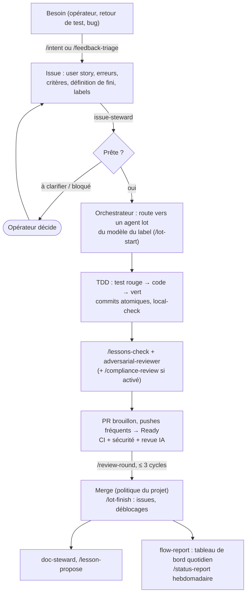

# Utiliser le harnais sur un projet : guide pas à pas (exemple SwiftHFR)

TL;DR : on **adopte** une fois (vendorisation, [ADOPTION](ADOPTION.md)), on **règle** `.harness/config.json`, puis
chaque besoin suit le même chemin : intention → issue prête → lot en TDD → revues → PR → tableau de bord. L'opérateur
ne parle qu'à l'orchestrateur.

## 1. Vue d'ensemble



## 2. Mise en place (une fois)

| Étape | Commande / fichier | Résultat |
|---|---|---|
| 1. Adopter | `harness-sync.sh --target .` ([ADOPTION](ADOPTION.md)) | `.harness/`, `.claude/skills/`, `.claude/agents/`, bloc `CLAUDE.md` |
| 2. Régler | `.harness/config.json` : branches, langue, exclusions, `compliance` (agent du cadre, agent de l'entreprise ou spec) | Règles et relecteurs adaptés au projet ; toute brique remplaçable ([ADOPTION](ADOPTION.md) §Remplacer) |
| 3. Labels | `.github/labels.local.json` + job `labels` de `harness.yml` | Taxonomie commune + labels du projet |
| 4. CI | `harness.yml` : jobs `flow`, `security`, `review` à activer | Tableau de bord, SAST/SCA/secrets, revue IA |
| 5. Secrets | `ANTHROPIC_API_KEY` (revue IA), `REPO_ADMIN_TOKEN` (réglages du dépôt), en secrets GitHub ; rien en dur ([CI-BUDGET](CI-BUDGET.md) §3) | — |
| 6. Jalons | Milestones GitHub (« Jalon 1 : … », échéance) | Avancement lisible dans le tableau de bord |

## 3. Au quotidien

| Je veux… | Je dis à l'orchestrateur | Ce qui se passe |
|---|---|---|
| Une nouvelle fonctionnalité | « /intent le fil se recharge seul toutes les 2 min » | Issue rédigée, montrée, créée après accord |
| Traiter des retours de test | « /feedback-triage » + les notes | Parapluie + une issue par point, regroupés en lots |
| Faire avancer le projet | « prends les issues prêtes » | Lots lancés en parallèle dans les bornes du système ([FINOPS](FINOPS.md) §3), agents nommés (`<projet>.<orc>.lot.<cible>`) |
| Savoir où on en est | « /status-report » | Rapport non technique : TL;DR RAG, jalons, blocages, décisions attendues |
| Une PR a des retours de bot | « /review-round #231 » | Un cycle complet, un push, une réponse par fil |
| Capitaliser une erreur | « /lesson-propose <constat> » | Leçon du projet, ou issue « Leçon » sur le cadre |
| Passer à la version suivante du cadre | « /harness-update » | PR de synchro en brouillon |

Quota atteint en cours de route : l'orchestrateur écrit l'état sur les issues, programme sa reprise à la remise à zéro
et repart de l'état du dépôt ([FINOPS](FINOPS.md) §3).

## 4. Exemple : SwiftHFR (`ezzz/HFRnow`, branche `dev-swift`)

Client iOS SwiftUI du forum HFR ; docs en anglais ; ses propres leçons (`docs/agents/LESSONS.md`), lots
(`docs/LOTS.md`) et labels (`type:`, `priority:`, `difficulty:`). Dépôt hors du compte `francoisgn` : pas d'appel aux
workflows réutilisables d'un cadre privé (ADR 0001) ; la vendorisation suffit.

**Configuration** (`.harness/config.json`, créée avant la première synchro) :
```json
{
  "language": "en",
  "exclude": [".github/ISSUE_TEMPLATE/*", ".github/pull_request_template.md", "docs/lots/TEMPLATE.md",
              ".markdownlint-cli2.jsonc", ".github/workflows/harness*.yml",
              ".claude/agents/compliance-tisax.md", ".claude/agents/compliance-pci.md",
              ".claude/agents/compliance-hds.md", ".claude/agents/compliance-soc2.md"],
  "protected_branches": ["master", "dev-swift"],
  "integration_branch": "dev-swift",
  "branch_model": "B",
  "compliance": ["gdpr"]
}
```
`gdpr` : l'app manipule un compte, des cookies de session et des messages privés (données personnelles) ; c'est une
proposition à confirmer par le mainteneur, pas une qualification juridique.

**Adoption** (session cloud avec `ezzz/HFRnow` et `francoisgn/agentic-harness` attachés, ou Mac) :
```bash
git fetch origin && git switch -c chore/adoption-harness origin/dev-swift
git clone --depth 1 --branch v0.3.0 https://github.com/francoisgn/agentic-harness.git ../agentic-harness
../agentic-harness/scripts/harness-sync.sh --target . --dry-run && ../agentic-harness/scripts/harness-sync.sh --target .
```

**Un lot de bout en bout** (issue #312, `LOT-082`, label `modèle: sonnet`) :
1. L'orchestrateur `hfrnow.orc-0711.orc.dev-swift` lit le tableau de bord, voit #312 prête, lance la session enfant
   `[hfrnow] lot LOT-082 #312 · sonnet ← orc-0711` (tags `projet:hfrnow`, `orc:orc-0711`, `issue:312`).
2. L'orchestrateur a commenté `/claim hfrnow.orc-0711.lot.LOT-082` sur #312 ; l'enfant lance `/lot-start 312 LOT-082` :
   il constate la prise à son identifiant, poste son plan, branche `lot/082-reader-links` depuis `dev-swift`.
3. TDD dans `HFRKit` (moteur, testable sous Linux) : tests Swift Testing rouges, puis code, puis verts
   (`swift test --filter`, en vérifiant que des tests ont tourné : L01). L'UI SwiftUI se relit avec une rigueur de
   compilateur (L58) ; le build Xcode se fait sur Mac ([MAC-HANDOFF](MAC-HANDOFF.md)).
4. `/lessons-check` (leçons du cadre **et** de HFRnow), puis sous-agent `adversarial-reviewer` en Opus
   (`hfrnow.orc-0711.rev.pr340`), puis `/compliance-review` : le diff touche le stockage des cookies → `compliance-gdpr`
   (`hfrnow.orc-0711.conf-gdpr.pr340`).
5. Pushes fréquents sur la PR brouillon (corps : `LOT-082`, `Closes #312`, `Claim: hfrnow.orc-0711.lot.LOT-082`, et
   `### Ledger` puisque HFRnow tient un registre), puis « Ready » : CI macOS, CodeRabbit ; `/review-round` pour ses
   constats, un commit par cycle, au plus 3 cycles.
6. Merge selon la politique de HFRnow ; `/lot-finish` débloque les lots dépendants ; une leçon générique née ici
   → `/lesson-propose` (issue « Leçon » sur le cadre).

## 5. Projet neuf (sans historique)
1. Créer le dépôt, `main` + `develop` (modèle A) ou une seule branche (modèle B) ; adopter le cadre (§2).
2. Premier lot : `docs/LOTS.md` (plan) et ADR 0001 du projet (architecture), produits par un agent `plan` de niveau
   frontière et relus par un autre modèle.
3. Activer `security` dès le premier commit de code : un secret ou une dépendance vulnérable coûte moins cher tôt.
