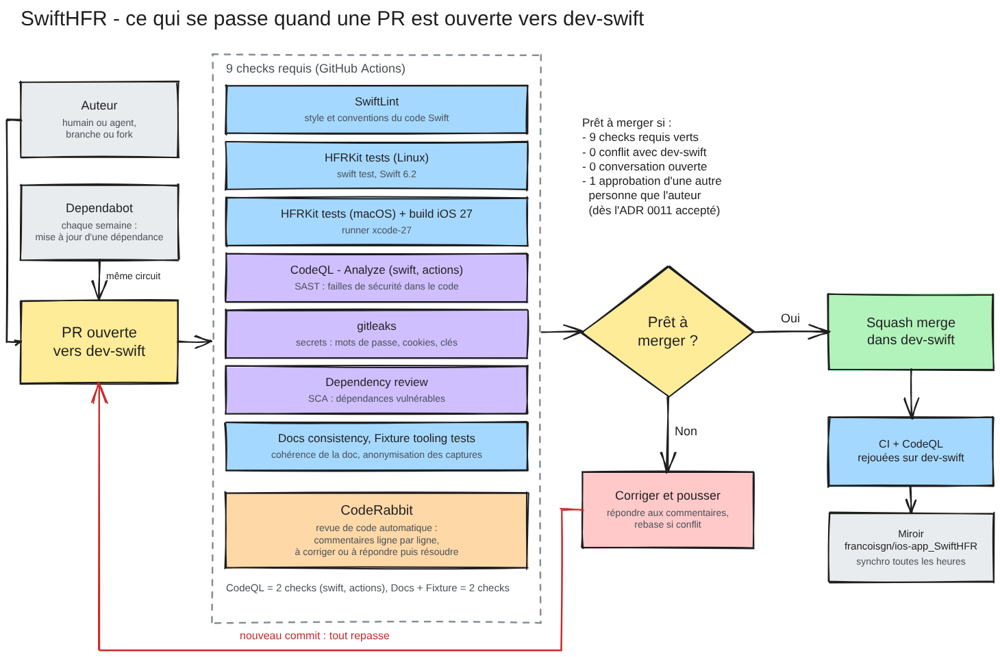

# Contributing

Thanks for helping! Humans and AI agents follow the same process. The rules are in **[AGENTS.md](AGENTS.md)**; this page is the path from a task to a merged PR.

## 1. From a task to a PR

1. Read **[AGENTS.md](AGENTS.md)** — guardrails, conventions, migration loop, labels, definition of done.
2. **Claim** before writing anything ([ORCHESTRATION](docs/agents/ORCHESTRATION.md#claims)):
   - an engine lot: owner + `in-progress` in [docs/LOTS.md](docs/LOTS.md);
   - anything else: an issue (open one if none exists), assigned to you, with its `status:` label.
3. Branch from **`dev-swift`** (`lot/…`, `fix/…`, `feat/…`, `chore/…`, `docs/…`); contributors without write access work from a fork. Never branch from or target `master`: it is the legacy app.
4. Work from **one description**: the spec file `docs/lots/LOT-XXX-*.md` for a lot, `docs/features/FEAT-XXX.md` for an app feature; the issue itself for a bug, a chore or a docs change. Never guess how HFR behaves ([AGENTS.md §3](AGENTS.md#3-ground-rules)).
5. Code with its tests; run `swift test --package-path Packages/HFRKit` and SwiftLint locally when you can; self-review against [LESSONS](docs/agents/LESSONS.md). Agent-written code is reviewed by a different model before the PR ([AGENTS.md §6](AGENTS.md#6-model-routing-which-agent-does-what)).
6. Open the PR against `dev-swift` with the template: `Closes #N` or `LOT-XXX`, what changed and why, the tests.

Issues: until the production switch the issue forms do not show (GitHub only reads them from the default branch, the legacy `master`); open a blank issue titled `[SwiftHFR] …` and set one label per axis ([AGENTS.md §7](AGENTS.md#7-labels-and-prioritization)).
Security problems go through [SECURITY.md](SECURITY.md), never a public issue.

## 2. Merge criteria

A PR into `dev-swift` is merged only when **all** of these hold (enforced by the [`dev-swift` ruleset](.github/rulesets/dev-swift.json)):

- [ ] **The 9 required checks are green**:

  | Check | What it verifies |
  |---|---|
  | `SwiftLint` | Style and conventions of the Swift code |
  | `HFRKit tests (Linux)` | The engine builds and its tests pass on Linux (Swift 6.2) |
  | `HFRKit tests (macOS) + iOS 27 build` | Same on macOS, plus a build for iOS 27 |
  | `Analyze (swift)` | CodeQL static analysis (SAST) of the Swift code; skipped, and counted as passed, when the PR touches no Swift |
  | `Analyze (actions)` | CodeQL analysis of the workflows |
  | `gitleaks` | No secret (password, cookie, key) in the PR's commits |
  | `review` | Dependency review (SCA): no dependency with a known vulnerability of moderate severity or more |
  | `Docs consistency` | Lot dependencies respect the module rules; markdown tables and links are valid |
  | `Fixture tooling tests` | The anonymizer works and the committed capture corpus holds no personal data |
- [ ] **No conflict** with `dev-swift`: rebase or merge `dev-swift` into the branch; everything runs again.
- [ ] **Every conversation is resolved**, CodeRabbit's included: for each comment, either fix and push, or reply why not — **then resolve the conversation**. A reply alone does not unblock the merge.
- [ ] **One approval by someone other than the author** — required once [ADR 0011](docs/adr/) is accepted and the ruleset updated.
- [ ] The [definition of done](AGENTS.md#9-definition-of-done) is met.

Every new commit re-runs the checks and CodeRabbit. The merge is a **squash** (one commit per PR). Only the repository owner can bypass these rules, for emergencies.
Dependabot PRs follow the same criteria. After the merge, CI and CodeQL run again on `dev-swift`, and the mirror `francoisgn/ios-app_SwiftHFR` follows within the hour.

Tool documentation: [CodeRabbit](https://docs.coderabbit.ai/) · [CodeQL](https://docs.github.com/en/code-security/code-scanning/introduction-to-code-scanning/about-code-scanning-with-codeql) · [Dependabot](https://docs.github.com/en/code-security/dependabot) · [dependency review](https://docs.github.com/en/code-security/supply-chain-security/understanding-your-software-supply-chain/about-dependency-review) · [secret scanning](https://docs.github.com/en/code-security/secret-scanning/introduction/about-secret-scanning) and [push protection](https://docs.github.com/en/code-security/secret-scanning/introduction/about-push-protection) · [gitleaks](https://github.com/gitleaks/gitleaks) · [SwiftLint](https://github.com/realm/SwiftLint) · [rulesets](https://docs.github.com/en/repositories/configuring-branches-and-merges-in-your-repository/managing-rulesets/about-rulesets).

## 3. License

By contributing you agree that your contribution is licensed under the [PolyForm Noncommercial License 1.0.0](LICENSE), except contributions to `docs/HFR-PROTOCOL.md` and to fixtures under `Packages/HFRKit/Tests/**/Fixtures/`, which are licensed under [CC BY 4.0](LICENSE-docs.md).
