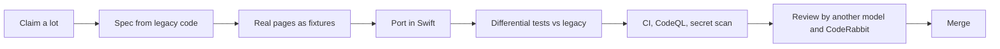

<p align="center">
  
</p>

<h1 align="center">SwiftHFR</h1>

<p align="center">
  <strong>The <a href="https://forum.hardware.fr">forum.hardware.fr</a> community, rebuilt as a native iOS app in Swift &amp; SwiftUI.</strong>
</p>

<table align="center">
  <tr>
    <td align="right"><sub><b>BUILD &amp; SECURITY</b></sub></td>
    <td>
      <a href="https://github.com/ezzz/HFRnow/actions/workflows/ci.yml?query=branch%3Adev-swift"></a>
      <a href="https://github.com/ezzz/HFRnow/actions/workflows/codeql.yml?query=branch%3Adev-swift"></a>
      <a href="https://github.com/ezzz/HFRnow/network/updates"></a>
      <a href="https://coderabbit.ai"></a>
    </td>
  </tr>
  <tr>
    <td align="right"><sub><b>STACK</b></sub></td>
    <td>
      <a href="Packages/HFRKit/Package.swift"></a>
      <a href="Packages/HFRKit/Package.swift"></a>
      <a href="docs/ARCHITECTURE.md"></a>
      <a href=".github/workflows/ci.yml"></a>
      <a href="Packages/HFRKit"></a>
    </td>
  </tr>
  <tr>
    <td align="right"><sub><b>PROJECT</b></sub></td>
    <td>
      <a href="LICENSE"></a>
      <a href="https://github.com/ezzz/HFRnow/commits/dev-swift"></a>
      <a href="https://github.com/ezzz/HFRnow/issues"></a>
      <a href="CONTRIBUTING.md"></a>
    </td>
  </tr>
</table>

<p align="center">
  <a href="#why">Why</a> ·
  <a href="#where-we-are">Where we are</a> ·
  <a href="#architecture">Architecture</a> ·
  <a href="#how-it-is-built">How it is built</a> ·
  <a href="#getting-started">Getting started</a> ·
  <a href="#contributing">Contributing</a> ·
  <a href="#license-and-credits">License</a> ·
  <a href="#support">Support</a>
</p>

---

## Why

HFR has had a community iOS app for more than a decade: **HFR+ → SuperHFR+ → HFRnow**. Each time maintainers moved on, someone forked it and carried on.
The result works, but it mixes Objective-C, abandoned vendor libraries and newer SwiftUI screens.

SwiftHFR keeps the spirit and restarts on a clean foundation: **100 % Swift, modular, tested, secure by default**, ready for the next generation of iPhones.

| | |
|---|---|
| **Native** | Swift 6.2 and SwiftUI, iOS 27+, strict concurrency. No Objective-C, no legacy vendor libraries. |
| **Modular** | A UI-free engine, `HFRKit`, split into five modules with enforced boundaries. |
| **Faithful** | Behavioural parity with the legacy app, proven by differential tests against its parsers. |
| **Modern UI** | Built for today's devices, including column-based navigation: forums → topics → messages. |
| **Secure** | SAST, SCA, secret scanning and AI code review on every change. |

## Where we are

> [!NOTE]
> **Nothing to install on a phone yet.** Real HFR pages and the legacy app's output are captured; the engine is being ported lot by lot. The first usable build (log in, browse, read) is defined in [LOTS.md](docs/LOTS.md#phase-4--app-first-usable-build).

| Phase | Scope | Status |
|---|---|---|
| 0 · Foundations | Repository, CI, security tooling, agent rules | **done** |
| 1 · Audit | Legacy engine mapped into [migration lots](docs/LOTS.md) (149 as of 2026-10-28) | **done** — [audit](docs/audit/README.md) |
| 2 · Fixtures | Real HFR pages + legacy parser output as test oracle | **done** — capture corpus and oracles LOT-001 to 005 |
| 3 · Engine | Models, parsing, network, storage, flows | **in progress** — 32 of 65 engine lots done (models, network base, storage, parsing of lists and topic pages, login, `hop` forms, post-form engine); the rest is in review or queued |
| 4 · App | SwiftUI app on top of `HFRKit` | **in progress** — app target, accounts and login, and navigation merged (LOT-080 to 082); topic reader in review (LOT-083); 76 app lots defined |
| 5 · iOS 27 experience | Column navigation, large and foldable layouts | planned |

Details and exit criteria: [roadmap](docs/ROADMAP.md).

## Architecture

<p align="center">
  
</p>

<sub>Editable source: <a href="docs/architecture/architecture.excalidraw">architecture.excalidraw</a> (open it on excalidraw.com).</sub>

| Module | Role | Depends on |
|---|---|---|
| `HFRModels` | Value types shared by every module | — |
| `HFRParsing` | HFR HTML → models, pure functions (SwiftSoup) | Models |
| `HFRNetwork` | URLSession transport, endpoints, per-account sessions and cookies | Models |
| `HFRStorage` | Settings, drafts, lists, offline reading, Keychain | Models |
| `HFRClient` | Multi-step flows: login, posting, search, MPStorage, alerts | Models, Parsing, Network |

Boundaries are enforced by `Package.swift` and checked in CI. Details: [ARCHITECTURE.md](docs/ARCHITECTURE.md) and the [decision records](docs/adr/).

## How it is built

SwiftHFR is developed by people **and AI agents** working in parallel, under rules written for both: **[AGENTS.md](AGENTS.md)**.
Every piece of the migration follows the same loop:



- **The legacy app is the oracle**: new parsers must reproduce its output on real, anonymized pages ([ADR 0004](docs/adr/0004-legacy-app-as-oracle.md)).
- **Different models for different jobs**: well-specified ports go to fast models, design and risky flows to stronger ones, and the reviewer is never the author ([routing](AGENTS.md#6-model-routing-which-agent-does-what)).
- **Mistakes become rules**: every review round feeds a [lessons table](docs/agents/LESSONS.md), and recurring classes of errors get automated checks.

## Documentation

[AGENTS.md](AGENTS.md) is the single entry point: it holds the rules and links to everything else. One file, one role:

| Document | Role |
|---|---|
| [AGENTS.md](AGENTS.md) | Operating manual for humans and agents: guardrails, conventions, workflow, learnings |
| [CONTRIBUTING.md](CONTRIBUTING.md) · [SECURITY.md](SECURITY.md) · [CREDITS.md](CREDITS.md) | How to contribute · how to report a vulnerability · who to thank |
| [docs/ARCHITECTURE.md](docs/ARCHITECTURE.md) | Modules and dependency rules |
| [docs/CHANGELOG-LEGACY.md](docs/CHANGELOG-LEGACY.md) | Legacy-app problems fixed by SwiftHFR (FR), base of the v1 changelog |
| [docs/ROADMAP.md](docs/ROADMAP.md) | Phases and their exit criteria |
| [docs/LOTS.md](docs/LOTS.md) | The migration plan: lots, dependencies, model routing, one issue each |
| [Issues](https://github.com/ezzz/HFRnow/issues) | The tracker: one issue per lot, capture, bug, chore or feature, claimed with `/claim`; MVP roadmap [#166](https://github.com/ezzz/HFRnow/issues/166) |
| [docs/lots/](docs/lots/) | One spec per engine lot — the file a lot is built from |
| [docs/FEATURES.md](docs/FEATURES.md) | The app feature backlog (FEAT-XXX): proposals with credit, status; the operator's UX principles |
| `docs/features/` | One spec per app feature (`FEAT-XXX.md`), created with the first feature |
| [docs/HFR-PROTOCOL.md](docs/HFR-PROTOCOL.md) | How forum.hardware.fr works, every fact with its source |
| [docs/FIXTURES.md](docs/FIXTURES.md) | How pages are captured and anonymized |
| [docs/adr/](docs/adr/) | Architecture decisions |
| [docs/agents/](docs/agents/) | Agent process: parallel sessions, review rounds, lessons |
| [docs/audit/](docs/audit/README.md) · [docs/research/](docs/research/) | Reference material: the legacy audit and its open questions, external comparisons |
| [docs/migration/EZZZ-CUTOVER.md](docs/migration/EZZZ-CUTOVER.md) | One-off runbook of the move to `ezzz/HFRnow`; deleted once its outcome is recorded in ADR 0010 |

## Getting started

The engine builds and tests on macOS or Linux with Swift 6.2+:

```sh
git clone --branch dev-swift https://github.com/ezzz/HFRnow.git SwiftHFR
cd SwiftHFR
swift test --package-path Packages/HFRKit
python3 scripts/check-lot-deps.py   # migration plan respects module boundaries
```

The iOS app (Xcode 27) is in `App/`: see [App/README](App/README.md). Work to pick up is on the [issues](https://github.com/ezzz/HFRnow/issues) (`status: ready`); the plan of the lots is [LOTS.md](docs/LOTS.md).

## Contributing

1. Read **[AGENTS.md](AGENTS.md)**, then [CONTRIBUTING.md](CONTRIBUTING.md).
2. Claim a [`status: ready` issue](https://github.com/ezzz/HFRnow/issues?q=is%3Aissue+is%3Aopen+label%3A%22status%3A+ready%22) nobody claimed, with a `/claim <your-id>` comment; [LOTS.md](docs/LOTS.md) is the plan of the migration lots, each linked to its issue.
3. Open a PR against `dev-swift` with `Closes #N` (or `Refs #N` for partial work) and `Claim: <your-id>`, naming its lot (`LOT-XXX`) if it is one; a small fix without an issue says `Direct-PR: <reason>`. It is merged only when it meets the **[merge criteria](CONTRIBUTING.md#2-merge-criteria)** — 9 required checks green, no conflict, every conversation resolved, and a review by a different model; no human approval is required, the author merges once all of these hold ([ADR 0011](docs/adr/0011-contribution-model-and-feature-intake.md)).

### Starting an agent

Paste this at the start of the session (Claude also loads [CLAUDE.md](CLAUDE.md), its guardrails):

```text
Read AGENTS.md and follow it. Repository ezzz/HFRnow: create a task branch from dev-swift,
never work on dev-swift itself, never touch master. Work only on issue #<N> (<LOT-XXX>), claimed first with /claim.
Write the spec and the tests before the code.
Stop and ask me when an HFR behaviour is not documented. Do not merge: open a PR that meets CONTRIBUTING.md §2.
```

Found a security issue? Follow [SECURITY.md](SECURITY.md), never a public issue.

<p align="center">
  <a href="https://github.com/ezzz/HFRnow/graphs/contributors"></a>
</p>

## License and credits

Code is licensed under [PolyForm Noncommercial 1.0.0](LICENSE): free to use, modify and share for any noncommercial purpose. Commercial use is not allowed, and the copyright notice must be kept.
The [HFR protocol documentation](docs/HFR-PROTOCOL.md) and the fixtures under `Packages/HFRKit/Tests/**/Fixtures/` are open under [CC BY 4.0](LICENSE-docs.md), so other community clients can reuse them.

SwiftHFR stands on the shoulders of the previous apps and their authors: see [CREDITS.md](CREDITS.md).
It is an independent community project, not affiliated with Hardware.fr.

## Support

If SwiftHFR is useful to you, star the repository to follow it, and support its development:

<p align="center">
  <a href="https://buymeacoffee.com/francoisgn"></a>
</p>
