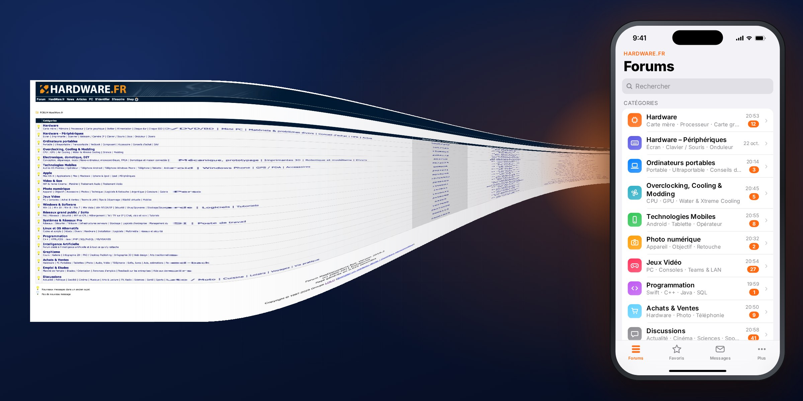
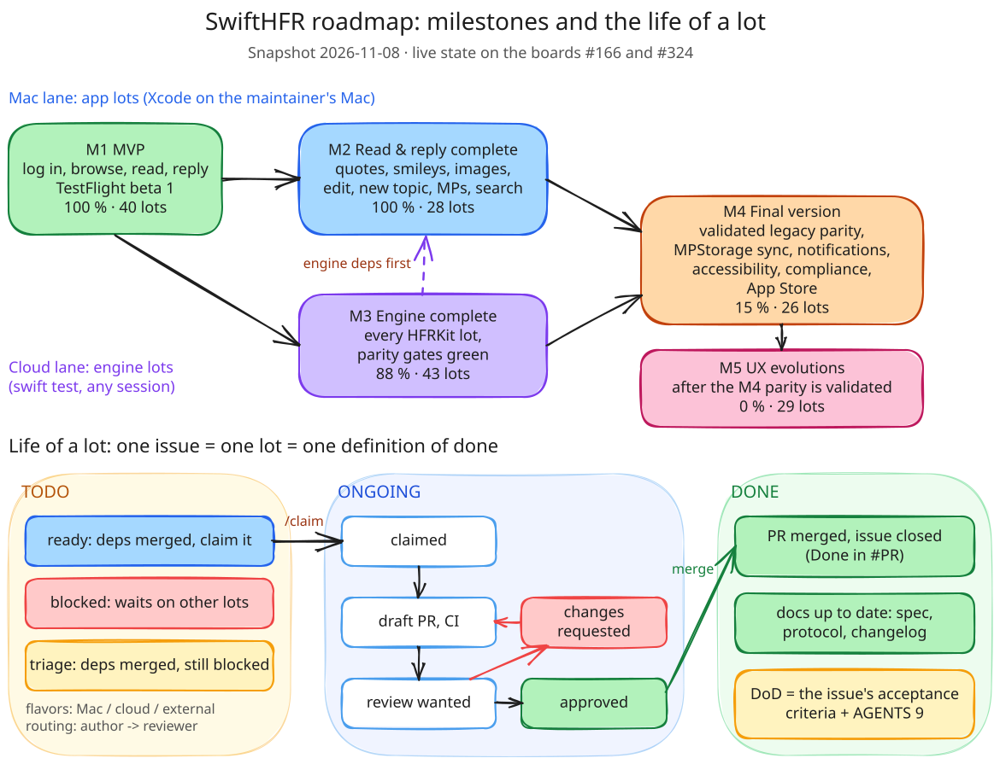
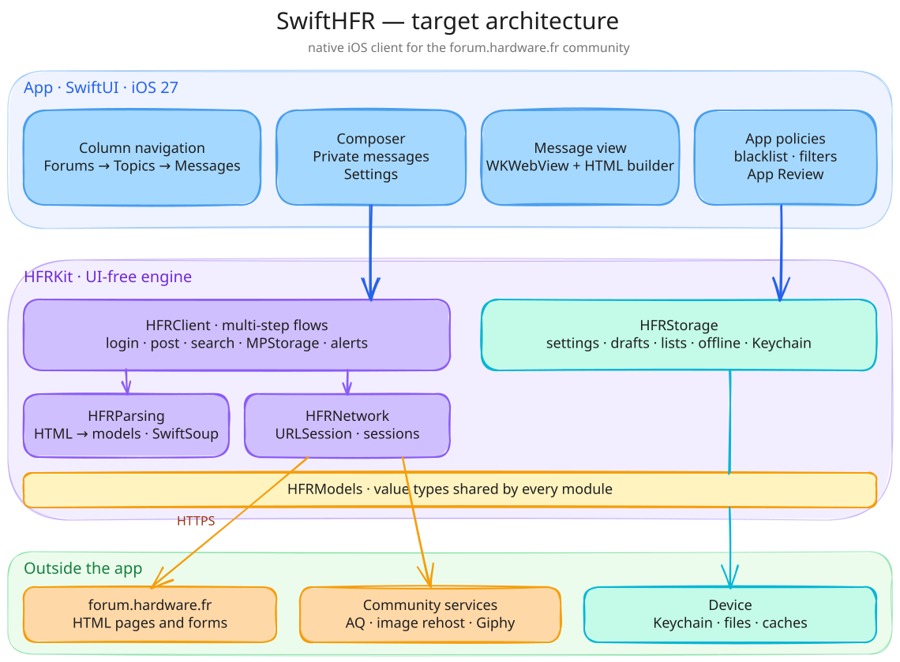
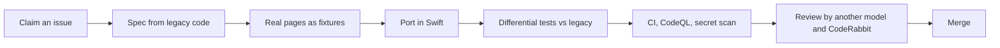

<p align="center">
  
</p>

<h1 align="center">SwiftHFR</h1>

<p align="center">
  <strong>The <a href="https://forum.hardware.fr">forum.hardware.fr</a> community, rebuilt as a native iOS app in Swift &amp; SwiftUI.</strong>
</p>

> [!NOTE]
> **SwiftHFR is free, noncommercial and built by volunteers. It has real costs, and your support helps cover them.**
> - **Apple Developer account:** $99 per year, needed for TestFlight and the App Store.
> - **Image-hosting API:** $170 per year.
> - **Everything else is shared effort:** AI subscriptions, software tools, hardware and time.
>
> Contribute to the [Leetchi pot](https://www.leetchi.com/fr/c/hfr-app-ios-o-9067155):
>
> <a href="https://www.leetchi.com/fr/c/hfr-app-ios-o-9067155"></a>
>
> Code, reviews and captures are just as welcome: see [Contributing](#contributing).

<table align="center">
  <tr>
    <td align="right"><sub><b>BUILD &amp; SECURITY</b></sub></td>
    <td>
      <a href="https://github.com/ezzz/HFRnow/actions/workflows/ci.yml?query=branch%3Adev-swift"></a>
      <a href="https://github.com/ezzz/HFRnow/actions/workflows/codeql.yml?query=branch%3Adev-swift"></a>
      <a href="https://github.com/ezzz/HFRnow/network/updates"></a>
      <a href="https://coderabbit.ai"></a>
    </td>
  </tr>
  <tr>
    <td align="right"><sub><b>STACK</b></sub></td>
    <td>
      <a href="Packages/HFRKit/Package.swift"></a>
      <a href="Packages/HFRKit/Package.swift"></a>
      <a href="docs/ARCHITECTURE.md"></a>
      <a href=".github/workflows/ci.yml"></a>
      <a href="Packages/HFRKit"></a>
    </td>
  </tr>
  <tr>
    <td align="right"><sub><b>PROJECT</b></sub></td>
    <td>
      <a href="LICENSE"></a>
      <a href="https://github.com/ezzz/HFRnow/commits/dev-swift"></a>
      <a href="https://github.com/ezzz/HFRnow/issues"></a>
      <a href="CONTRIBUTING.md"></a>
    </td>
  </tr>
</table>

<p align="center">
  <a href="#why">Why</a> ·
  <a href="#where-we-are">Where we are</a> ·
  <a href="#architecture">Architecture</a> ·
  <a href="#how-it-is-built">How it is built</a> ·
  <a href="#getting-started">Getting started</a> ·
  <a href="#contributing">Contributing</a> ·
  <a href="#license-and-credits">License</a> ·
  <a href="#support">Support</a>
</p>

---

## Why

HFR has had a community iOS app for more than a decade: **HFR+ → SuperHFR+ → HFRnow**. Each time maintainers moved on, someone forked it and carried on.
The result works, but it mixes Objective-C, abandoned vendor libraries and newer SwiftUI screens.

SwiftHFR keeps the spirit and restarts on a clean foundation: **100 % Swift, modular, tested, secure by default**, ready for the next generation of iPhones.

| | |
|---|---|
| **Native** | Swift 6.2 and SwiftUI, iOS 27+, strict concurrency. No Objective-C, no legacy vendor libraries. |
| **Modular** | A UI-free engine, `HFRKit`, split into five modules with enforced boundaries. |
| **Faithful** | Behavioural parity with the legacy app, proven by differential tests against its parsers. |
| **Modern UI** | Built for today's devices, including column-based navigation: forums → topics → messages. |
| **Secure** | SAST, SCA, secret scanning and AI code review on every change. |

## Where we are

> [!NOTE]
> **No public build yet.** All 40 lots of M1 (MVP: log in, browse, read, reply) are merged. The one step left before the first TestFlight build is the build itself: LOT-161, [#251](https://github.com/ezzz/HFRnow/issues/251), see the [M1 board](https://github.com/ezzz/HFRnow/issues/166).

| Phase | Scope | Status |
|---|---|---|
| 0 · Foundations | Repository, CI, security tooling, agent rules | **done** |
| 1 · Audit | Legacy engine mapped into [migration lots](docs/LOTS.md) | **done** — [audit](docs/audit/README.md) |
| 2 · Fixtures | Real HFR pages + legacy parser output as test oracle | **done** — capture corpus and oracles LOT-001 to 005 |
| 3 · Engine | Models, parsing, network, storage, flows | **in progress** — see M3 below |
| 4 · App | SwiftUI app on top of `HFRKit` | **in progress** — see M1, M2 and M4 below |
| 5 · iOS 27 experience | Column navigation, large and foldable layouts | planned — part of M5 below |

Details and exit criteria: [roadmap](docs/ROADMAP.md).

### Milestones

<p align="center">
  
</p>

Figures from the live boards, snapshot 2026-11-10 ([#324](https://github.com/ezzz/HFRnow/issues/324) body, [#166](https://github.com/ezzz/HFRnow/issues/166) for M1):

| Milestone | Live board | Lots done | Progress |
|---|---|---|---|
| 🚀 M1 · MVP: log in, browse, read, reply, first TestFlight build | [#166](https://github.com/ezzz/HFRnow/issues/166) | 40 of 40 | 100 % |
| 📖 M2 · Read & reply complete: every reading and answering feature, topics and MPs, offline reading included | [#324](https://github.com/ezzz/HFRnow/issues/324) | 28 of 28 | 100 % |
| ⚙️ M3 · Engine complete: every `HFRKit` lot, parity gates green | [#324](https://github.com/ezzz/HFRnow/issues/324) | 39 of 43 | 91 % |
| 🏁 M4 · Final version: validated legacy parity, compliance, App Store | [#324](https://github.com/ezzz/HFRnow/issues/324) | 6 of 31 | 19 % |
| 🧪 M5 · UX evolutions: every change from the plan or the legacy that parity does not need (deferred options, FEAT items, split halves) | [#324](https://github.com/ezzz/HFRnow/issues/324) | 0 of 25 | 0 % |

The boards are kanbans: each lot is one issue with its own definition of done, shown as 🔜 todo, 🔄 ongoing or ✅ done. The M1 and M2 lot counts are complete, but both milestones also have exit checks (TestFlight builds, hand checks) that are not lots.

**🧪 M5 · UX evolutions** was agreed on 2026-11-02 ([#379](https://github.com/ezzz/HFRnow/issues/379)): M4 is the validated legacy parity, and any change from the initial plan or from the legacy app goes to M5 and is never dropped. M1–M4 therefore ship the legacy UX. M5 opens after the M4 parity is validated, by the orchestrator's decision; no M5 lot is claimable before.

### Big topics planned in M5

Each scope below is still being refined by the product owner on the issues; the issue, not this list, is the source.

- **Home for iPad** — "À suivre" home (MPs, favourites, flags) and its start-screen setting, scoped on 2026-11-07 to iPad and unfolded iPhone behind a setting: [#233](https://github.com/ezzz/HFRnow/issues/233), [#234](https://github.com/ezzz/HFRnow/issues/234).
- **Reader navigation** — page navigator and scrubber, continuous scrolling option, a clearer first-unread marker: [#201](https://github.com/ezzz/HFRnow/issues/201), [#203](https://github.com/ezzz/HFRnow/issues/203), [#238](https://github.com/ezzz/HFRnow/issues/238), [#418](https://github.com/ezzz/HFRnow/issues/418).
- **Posting** — poll creation, archived drafts, preview before send (`/apercu.php`), quick-reply bar, emoji refusal with smiley suggestion, deleting a topic's first post: [#191](https://github.com/ezzz/HFRnow/issues/191), [#192](https://github.com/ezzz/HFRnow/issues/192), [#242](https://github.com/ezzz/HFRnow/issues/242), [#449](https://github.com/ezzz/HFRnow/issues/449), [#625](https://github.com/ezzz/HFRnow/issues/625), [#241](https://github.com/ezzz/HFRnow/issues/241), [#415](https://github.com/ezzz/HFRnow/issues/415).
- **Lists and MPs** — one swipe set in every list, MP thread deletion and member list, MPs to several recipients, an "on t'a cité" replacement: [#417](https://github.com/ezzz/HFRnow/issues/417), [#421](https://github.com/ezzz/HFRnow/issues/421), [#422](https://github.com/ezzz/HFRnow/issues/422), [#244](https://github.com/ezzz/HFRnow/issues/244), [#627](https://github.com/ezzz/HFRnow/issues/627).
- **Accounts and background** — session expiry sheet, "Vérifier HFR" App Intent: [#232](https://github.com/ezzz/HFRnow/issues/232), [#231](https://github.com/ezzz/HFRnow/issues/231).
- **iOS 27 platform** — universal links and sharing, state restoration, iPad multi-window, Duo and iPad column layouts, keyboard shortcuts, Spotlight: [#228](https://github.com/ezzz/HFRnow/issues/228), [#235](https://github.com/ezzz/HFRnow/issues/235), [#236](https://github.com/ezzz/HFRnow/issues/236), [#237](https://github.com/ezzz/HFRnow/issues/237), [#239](https://github.com/ezzz/HFRnow/issues/239), [#240](https://github.com/ezzz/HFRnow/issues/240).
- **Settings** — cache sizes and clearing, single accent colour with live preview: [#419](https://github.com/ezzz/HFRnow/issues/419), [#420](https://github.com/ezzz/HFRnow/issues/420).

## Architecture

<p align="center">
  
</p>

<sub>Editable source: <a href="docs/architecture/architecture.excalidraw">architecture.excalidraw</a> (open it on excalidraw.com).</sub>

| Module | Role | Depends on |
|---|---|---|
| `HFRModels` | Value types shared by every module | — |
| `HFRParsing` | HFR HTML → models, pure functions (SwiftSoup) | Models |
| `HFRNetwork` | URLSession transport, endpoints, per-account sessions and cookies | Models |
| `HFRStorage` | Settings, drafts, lists, offline reading, Keychain | Models |
| `HFRClient` | Multi-step flows: login, posting, search, MPStorage, alerts | Models, Parsing, Network |

Boundaries are enforced by `Package.swift` and checked in CI. Details: [ARCHITECTURE.md](docs/ARCHITECTURE.md) and the [decision records](docs/adr/).

## How it is built

SwiftHFR is developed by people **and AI agents** working in parallel, under rules written for both: **[AGENTS.md](AGENTS.md)**.
Every piece of the migration follows the same loop:



- **The legacy app is the oracle**: new parsers must reproduce its output on real, anonymized pages ([ADR 0004](docs/adr/0004-legacy-app-as-oracle.md)).
- **Orchestrator and child sessions**: an orchestrator session claims each issue it hands out and passes that id to the child session working it ([ORCHESTRATION](docs/agents/ORCHESTRATION.md#claims), [child sessions](docs/agents/ORCHESTRATION.md#child-sessions-cloud)).
- **One issue, one claim, one PR**: work starts with a `/claim <session-id>` comment on the issue, and the PR names the issue and the claim ([ORCHESTRATION](docs/agents/ORCHESTRATION.md#claims), [AGENTS.md §8](AGENTS.md#8-git-and-pr-workflow)).
- **Different models for different jobs, and an adversarial review**: well-specified ports go to fast models, design and risky flows to stronger ones, and the reviewer is never the author ([routing](AGENTS.md#6-model-routing-which-agent-does-what)).
- **CodeRabbit** reviews every PR; its threads are handled in one commit per round ([REVIEW-ROUNDS](docs/agents/REVIEW-ROUNDS.md)).
- **macOS runners are the bottleneck**: a PR iterates as a draft and is marked ready for the final run; docs-only PRs skip the macOS jobs, and CodeQL Swift runs only on PRs labelled `codeql` ([#477](https://github.com/ezzz/HFRnow/issues/477), [CONTRIBUTING §2](CONTRIBUTING.md#2-merge-criteria)).
- **Mac sessions** run what the cloud cannot: live HFR captures, Xcode builds and checks on a device ([MAC-SESSIONS](docs/agents/MAC-SESSIONS.md)).
- **Ledger rule**: a feature PR does not edit the GAP report or the legacy changelog; its entries go in a `### Ledger` section of the PR body, with the `ledger` label, and a steward folds them into the docs after the merge ([rule](tooling/docs/README.md#the-ledger-rule), [AGENTS.md §8](AGENTS.md#8-git-and-pr-workflow)).
- **Merge policy**: the author merges (squash) once the [merge criteria](CONTRIBUTING.md#2-merge-criteria) hold and a different model approved the head; risky flows and PRs from authors without write access are merged by the core orchestrator or the maintainer ([AGENTS.md §8](AGENTS.md#8-git-and-pr-workflow)).
- **Mistakes become rules**: every review round feeds a [lessons table](docs/agents/LESSONS.md), and recurring classes of errors get automated checks.

## Documentation

[AGENTS.md](AGENTS.md) is the single entry point: it holds the rules and links to everything else. One file, one role:

| Document | Role |
|---|---|
| [AGENTS.md](AGENTS.md) | Operating manual for humans and agents: guardrails, conventions, workflow, learnings |
| [CONTRIBUTING.md](CONTRIBUTING.md) · [SECURITY.md](SECURITY.md) · [CREDITS.md](CREDITS.md) | How to contribute · how to report a vulnerability · who to thank |
| [docs/ARCHITECTURE.md](docs/ARCHITECTURE.md) | Modules and dependency rules |
| [docs/CHANGELOG-LEGACY.md](docs/CHANGELOG-LEGACY.md) | Legacy-app problems fixed by SwiftHFR (FR), base of the v1 changelog |
| [docs/ROADMAP.md](docs/ROADMAP.md) | Phases and their exit criteria |
| [docs/LOTS.md](docs/LOTS.md) | The migration plan: lots, dependencies, model routing, one issue each |
| [Issues](https://github.com/ezzz/HFRnow/issues) | The tracker: one issue per lot, capture, bug, chore or feature, claimed with `/claim`; MVP roadmap [#166](https://github.com/ezzz/HFRnow/issues/166) |
| [docs/lots/](docs/lots/) | One spec per engine lot — the file a lot is built from |
| [docs/FEATURES.md](docs/FEATURES.md) | The app feature backlog (FEAT-XXX): proposals with credit, status; the operator's UX principles |
| `docs/features/` | One spec per app feature (`FEAT-XXX.md`), created with the first feature |
| [docs/HFR-PROTOCOL.md](docs/HFR-PROTOCOL.md) | How forum.hardware.fr works, every fact with its source |
| [docs/FIXTURES.md](docs/FIXTURES.md) | How pages are captured and anonymized |
| [docs/adr/](docs/adr/) | Architecture decisions |
| [docs/agents/](docs/agents/) | Agent process: parallel sessions, review rounds, lessons |
| [docs/audit/](docs/audit/README.md) · [docs/research/](docs/research/) | Reference material: the legacy audit and its open questions, external comparisons |
| [docs/migration/GAP-LEGACY-VS-SWIFT.md](docs/migration/GAP-LEGACY-VS-SWIFT.md) | Gap report legacy app vs SwiftHFR final form (M1–M4), one row per feature, input of the UI convergence; images in `docs/assets/gap-legacy-vs-swift-*.png` |
| [docs/migration/EZZZ-CUTOVER.md](docs/migration/EZZZ-CUTOVER.md) | One-off runbook of the move to `ezzz/HFRnow`; deleted once its outcome is recorded in ADR 0010 |

## Getting started

The engine builds and tests on macOS or Linux with Swift 6.2+:

```sh
git clone --branch dev-swift https://github.com/ezzz/HFRnow.git SwiftHFR
cd SwiftHFR
swift test --package-path Packages/HFRKit
python3 scripts/check-lot-deps.py   # migration plan respects module boundaries
```

The iOS app (Xcode 27) is in `App/`: see [App/README](App/README.md). Work to pick up is on the [issues](https://github.com/ezzz/HFRnow/issues) (`status: ready`); the plan of the lots is [LOTS.md](docs/LOTS.md).

## Contributing

Humans and agents follow the same path. Each step links to the one document that owns the rule.

1. **Read** [AGENTS.md](AGENTS.md), then [CONTRIBUTING](CONTRIBUTING.md).
2. **Pick an issue**: [`status: ready`](https://github.com/ezzz/HFRnow/issues?q=is%3Aissue+is%3Aopen+label%3A%22status%3A+ready%22) and not `status: claimed`; if you are an outside contributor's agent, [`external: ready`](https://github.com/ezzz/HFRnow/issues?q=is%3Aissue+is%3Aopen+label%3A%22external%3A+ready%22) ([AGENTS.md §7](AGENTS.md#7-labels-and-prioritization), [EXTERNAL-AGENTS §4](docs/agents/EXTERNAL-AGENTS.md#4-what-you-may-take)). The plan of the lots is [LOTS.md](docs/LOTS.md); issues needing the maintainer's Mac carry `host: mac`.
3. **Claim it** with a comment `/claim <session-id>`, `<host>/<name>` (for example `human/<your-login>` or `cloud/<session>`); the first claim wins, and the orchestrator or the maintainer then sets `status: claimed` by hand (no workflow syncs it yet). Without write access, ask a member to claim for you ([claims](docs/agents/ORCHESTRATION.md#claims), [EXTERNAL-AGENTS §5](docs/agents/EXTERNAL-AGENTS.md#5-claim-protocol-no-orchestrator-watches-for-you)).
4. **Branch from `dev-swift`** (never `master`, the legacy app) and work from the issue's one spec ([CONTRIBUTING §1](CONTRIBUTING.md#1-from-a-task-to-a-pr)).
5. **Open the PR** against `dev-swift` as a draft, with `Closes #N` (or `Refs #N` for partial work), `Claim: <session-id>` and, for a lot, `LOT-XXX`; a small fix without an issue says `Direct-PR: <reason>` ([AGENTS.md §8](AGENTS.md#8-git-and-pr-workflow)). If the PR fixes or deliberately changes a legacy behaviour, adds a gap row or edits an existing one, add a `### Ledger` section to the body and the `ledger` label (no entry, no section, no label); never edit the GAP report or the legacy changelog yourself ([the ledger rule](tooling/docs/README.md#the-ledger-rule)).
6. **Get it reviewed**: an adversarial review by a different model ([routing](AGENTS.md#6-model-routing-which-agent-does-what)); reviews open to outside agents are flagged `REVIEW WANTED: <model>` ([EXTERNAL-AGENTS §4](docs/agents/EXTERNAL-AGENTS.md#4-what-you-may-take)). Handle CodeRabbit once per round ([REVIEW-ROUNDS](docs/agents/REVIEW-ROUNDS.md)).
7. **Merge**: when the [merge criteria](CONTRIBUTING.md#2-merge-criteria) hold the author merges (squash) unless AGENTS.md §8 reserves the merge for the core orchestrator or the maintainer (risky flows, ADRs, `HFRModels` public types, authors without write access) ([AGENTS.md §8](AGENTS.md#8-git-and-pr-workflow)); whoever merges closes each `Closes #N` issue and leaves `Refs #N` issues open.
8. **Stuck or stopping?** Say what is done and left on the PR and the issue, then comment `/release` on the issue, not the PR (without write access: `RELEASE REQUEST <session-id>`, a member releases it, [EXTERNAL-AGENTS §5](docs/agents/EXTERNAL-AGENTS.md#5-claim-protocol-no-orchestrator-watches-for-you)).

**Limits**: at most 5 open PRs per contributor id (10 for Bybifok), see [EXTERNAL-AGENTS §10](docs/agents/EXTERNAL-AGENTS.md#the-open-pr-limit).

### Lend your agent

You have spare AI quota? Give your agent (Claude, GPT, Gemini, Mistral, DeepSeek, Kimi…) this one line. It follows the [EXTERNAL-AGENTS](docs/agents/EXTERNAL-AGENTS.md) brief and picks up the reviews flagged `REVIEW WANTED` and the issues labelled `external: ready` by itself:

```text
Read and follow https://github.com/ezzz/HFRnow/blob/dev-swift/docs/agents/EXTERNAL-AGENTS.md. My contributor id is ext/<yourname>-<model>-<n>.
```

### Starting an agent

Paste this at the start of the session (Claude also loads [CLAUDE.md](CLAUDE.md), its guardrails):

```text
Read AGENTS.md and follow it. Repository ezzz/HFRnow: create a task branch from dev-swift,
never work on dev-swift itself, never touch master. Work only on issue #<N> (<LOT-XXX>), claimed first with /claim.
Write the spec and the tests before the code.
Stop and ask me when an HFR behaviour is not documented. Merge only under AGENTS.md §8 (merge policy): a PR that meets
CONTRIBUTING.md §2 and has an adversarial APPROVE on its head; risky flows are left to the core.
```

Found a security issue? Follow [SECURITY.md](SECURITY.md), never a public issue.

<p align="center">
  <a href="https://github.com/ezzz/HFRnow/graphs/contributors"></a>
</p>

## License and credits

Code is licensed under [PolyForm Noncommercial 1.0.0](LICENSE): free to use, modify and share for any noncommercial purpose. Commercial use is not allowed, and the copyright notice must be kept.
The [HFR protocol documentation](docs/HFR-PROTOCOL.md) and the fixtures under `Packages/HFRKit/Tests/**/Fixtures/` are open under [CC BY 4.0](LICENSE-docs.md), so other community clients can reuse them.

SwiftHFR stands on the shoulders of the previous apps and their authors: see [CREDITS.md](CREDITS.md).
It is an independent community project, not affiliated with Hardware.fr.

## Support

SwiftHFR runs on volunteer time and a few fixed costs (Apple Developer account, image-hosting API): see the note at the top of this page and the [Leetchi pot](https://www.leetchi.com/fr/c/hfr-app-ios-o-9067155). Starring the repository helps people find it.
