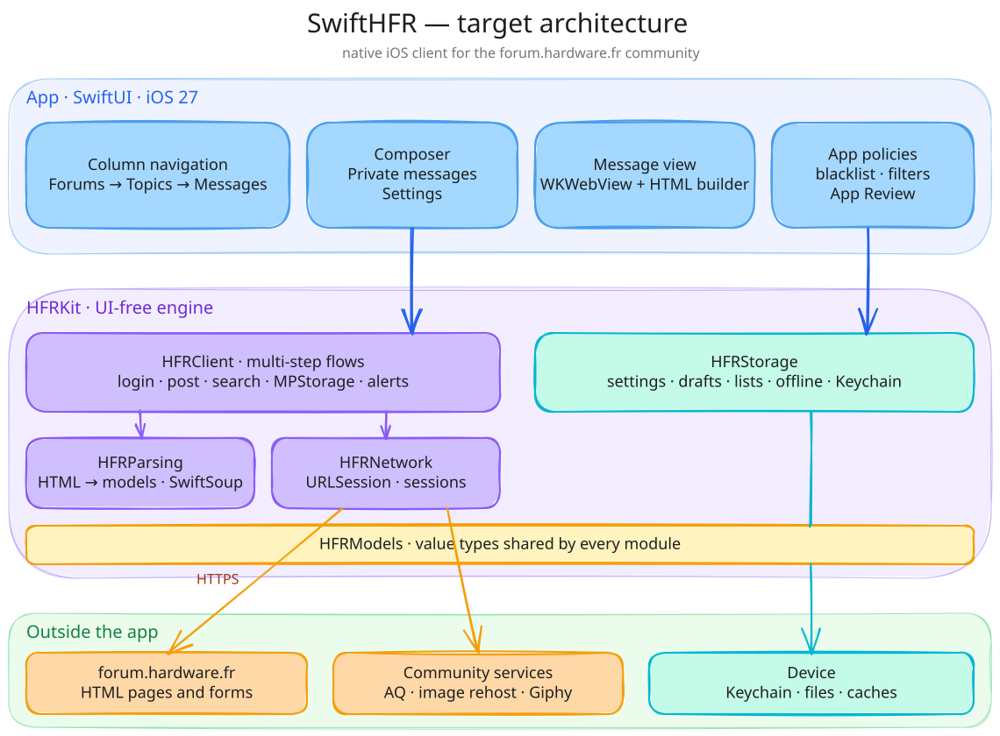
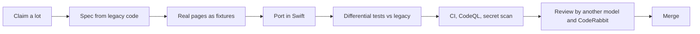

<p align="center">
  
</p>

<h1 align="center">SwiftHFR</h1>

<p align="center">
  <strong>The <a href="https://forum.hardware.fr">forum.hardware.fr</a> community, rebuilt as a native iOS app in Swift &amp; SwiftUI.</strong>
</p>

<table align="center">
  <tr>
    <td align="right"><sub><b>BUILD &amp; SECURITY</b></sub></td>
    <td>
      <a href="https://github.com/francoisgn/ios-app_SwiftHFR/actions/workflows/ci.yml"></a>
      <a href="https://github.com/francoisgn/ios-app_SwiftHFR/actions/workflows/codeql.yml"></a>
      <a href="https://scorecard.dev/viewer/?uri=github.com/francoisgn/ios-app_SwiftHFR"></a>
      <a href="https://github.com/francoisgn/ios-app_SwiftHFR/network/updates"></a>
      <a href="https://coderabbit.ai"></a>
    </td>
  </tr>
  <tr>
    <td align="right"><sub><b>STACK</b></sub></td>
    <td>
      <a href="Packages/HFRKit/Package.swift"></a>
      <a href="Packages/HFRKit/Package.swift"></a>
      <a href="docs/ARCHITECTURE.md"></a>
      <a href=".github/workflows/ci.yml"></a>
      <a href="Packages/HFRKit"></a>
    </td>
  </tr>
  <tr>
    <td align="right"><sub><b>PROJECT</b></sub></td>
    <td>
      <a href="LICENSE"></a>
      <a href="https://github.com/francoisgn/ios-app_SwiftHFR/commits/master"></a>
      <a href="https://github.com/francoisgn/ios-app_SwiftHFR/issues"></a>
      <a href="CONTRIBUTING.md"></a>
    </td>
  </tr>
</table>

<p align="center">
  <a href="#why">Why</a> ·
  <a href="#where-we-are">Where we are</a> ·
  <a href="#architecture">Architecture</a> ·
  <a href="#how-it-is-built">How it is built</a> ·
  <a href="#getting-started">Getting started</a> ·
  <a href="#contributing">Contributing</a> ·
  <a href="#license-and-credits">License</a> ·
  <a href="#support">Support</a>
</p>

---

## Why

HFR has had a community iOS app for more than a decade: **HFR+ → SuperHFR+ → HFRnow**. Each time maintainers moved on, someone forked it and carried on.
The result works, but it mixes Objective-C, abandoned vendor libraries and newer SwiftUI screens.

SwiftHFR keeps the spirit and restarts on a clean foundation: **100 % Swift, modular, tested, secure by default**, ready for the next generation of iPhones.

| | |
|---|---|
| **Native** | Swift 6.2 and SwiftUI, iOS 27+, strict concurrency. No Objective-C, no legacy vendor libraries. |
| **Modular** | A UI-free engine, `HFRKit`, split into five modules with enforced boundaries. |
| **Faithful** | Behavioural parity with the legacy app, proven by differential tests against its parsers. |
| **Modern UI** | Built for today's devices, including column-based navigation: forums → topics → messages. |
| **Secure** | SAST, SCA, secret scanning and AI code review on every change. |

## Where we are

> [!NOTE]
> **Nothing to install on a phone yet.** The foundations and the full audit of the legacy app are done; the engine migration starts now.

| Phase | Scope | Status |
|---|---|---|
| 0 · Foundations | Repository, CI, security tooling, agent rules | **done** |
| 1 · Audit | Legacy engine mapped into [54 migration lots](docs/LOTS.md) (one since dropped) | **done** — [audit](docs/audit/README.md) |
| 2 · Fixtures | Real HFR pages + legacy parser output as test oracle | next |
| 3 · Engine | Models, parsing, network, storage, flows | starting (16 lots need no fixtures) |
| 4 · App | SwiftUI app on top of `HFRKit` | planned |
| 5 · iOS 27 experience | Column navigation, large and foldable layouts | planned |

Details and exit criteria: [roadmap](docs/ROADMAP.md).

## Architecture

<p align="center">
  
</p>

<sub>Editable source: <a href="docs/architecture/architecture.excalidraw">architecture.excalidraw</a> (open it on excalidraw.com).</sub>

| Module | Role | Depends on |
|---|---|---|
| `HFRModels` | Value types shared by every module | — |
| `HFRParsing` | HFR HTML → models, pure functions (SwiftSoup) | Models |
| `HFRNetwork` | URLSession transport, endpoints, per-account sessions and cookies | Models |
| `HFRStorage` | Settings, drafts, lists, offline reading, Keychain | Models |
| `HFRClient` | Multi-step flows: login, posting, search, MPStorage, alerts | Models, Parsing, Network |

Boundaries are enforced by `Package.swift` and checked in CI. Details: [ARCHITECTURE.md](docs/ARCHITECTURE.md) and the [decision records](docs/adr/).

## How it is built

SwiftHFR is developed by people **and AI agents** working in parallel, under rules written for both: **[AGENTS.md](AGENTS.md)**.
Every piece of the migration follows the same loop:



- **The legacy app is the oracle**: new parsers must reproduce its output on real, anonymized pages ([ADR 0004](docs/adr/0004-legacy-app-as-oracle.md)).
- **Different models for different jobs**: well-specified ports go to fast models, design and risky flows to stronger ones, and the reviewer is never the author ([routing](AGENTS.md#6-model-routing-which-agent-does-what)).
- **Mistakes become rules**: every review round feeds a [lessons table](docs/agents/LESSONS.md), and recurring classes of errors get automated checks.

| Document | What it holds |
|---|---|
| [AGENTS.md](AGENTS.md) | Operating manual for humans and agents |
| [docs/LOTS.md](docs/LOTS.md) | The migration plan: lots, owners, dependencies |
| [docs/HFR-PROTOCOL.md](docs/HFR-PROTOCOL.md) | How forum.hardware.fr works, with sources |
| [docs/audit/](docs/audit/README.md) | The legacy engine audit and its independent review |
| [docs/adr/](docs/adr/) | Architecture decisions |

## Getting started

The engine builds and tests on macOS or Linux with Swift 6.2+:

```sh
git clone https://github.com/francoisgn/ios-app_SwiftHFR.git
cd ios-app_SwiftHFR
swift test --package-path Packages/HFRKit
python3 scripts/check-lot-deps.py   # migration plan respects module boundaries
```

The iOS app target (Xcode 27) is created before the app phase.

## Contributing

1. Read **[AGENTS.md](AGENTS.md)**, then [CONTRIBUTING.md](CONTRIBUTING.md).
2. Pick a free [migration lot](docs/LOTS.md) or an issue labelled `status: ready` ([label guide](AGENTS.md#7-labels-and-prioritization)).
3. Open a PR: CI, CodeQL and CodeRabbit review it.

Found a security issue? Follow [SECURITY.md](SECURITY.md), never a public issue.

<p align="center">
  <a href="https://github.com/francoisgn/ios-app_SwiftHFR/graphs/contributors"></a>
</p>

## License and credits

Licensed under [PolyForm Noncommercial 1.0.0](LICENSE): free to use, modify and share for any noncommercial purpose. Commercial use is not allowed, and the copyright notice must be kept.

SwiftHFR stands on the shoulders of the previous apps and their authors: see [CREDITS.md](CREDITS.md).
It is an independent community project, not affiliated with Hardware.fr.

## Support

If SwiftHFR is useful to you, star the repository to follow it, and support its development:

<p align="center">
  <a href="https://buymeacoffee.com/francoisgn"></a>
</p>
