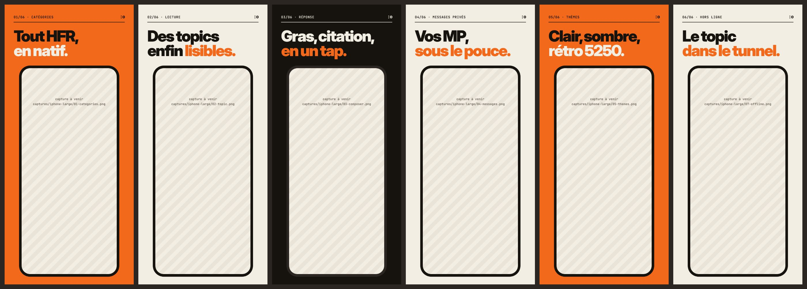

# App Store visuals (#1381)

The art direction and the composition sources of the App Store screenshots. **State: art direction only.** No capture exists yet, so no final image is here; `art-direction.jpg` shows the phone frames with placeholders.



## Art direction (proposal, operator to confirm)

The language of the `:o` social preview (#1380), not the README hero's: an App Store page is a row of small portrait cards, where a flat poster reads better than a perspective scene, and the screenshot itself already is « the app on a phone ».

| Element | Rule |
|---|---|
| Background | Three flat inks in turn: HFR orange `#F2691C`, paper `#F3EEE4`, ink `#16130F`. No gradient, no texture |
| Caption | French, two short lines, Inter 900, tight; the second line (or its key words) in the accent colour. At most about 15 characters per line: `render.js` refuses a line wider than 94 % of the column at any rendered size |
| Kicker | One monospace line above a rule: `01/07 · CATÉGORIES`, and the `:o` signature on the right |
| Screenshot | The whole capture, never cropped, in a plain dark slab with rounded corners: no maker's detail (no island, button or lens), no device name |
| Tone | The forum's own voice: short, concrete, no superlative. A caption says only what its capture shows and the default build does |

## Screens and captions (proposal, operator to confirm)

The list is `source/screens.json` (`*word*` = accent colour, `|` = line break).

| # | Capture | Kicker | Caption |
|---|---|---|---|
| 1 | `01-categories` | Catégories | Tout HFR, / en natif. |
| 2 | `02-topic` | Lecture | Des topics / enfin lisibles. |
| 3 | `03-composer` | Réponse | Gras, citation, / en un tap. (the formatting bar, `App/SwiftHFR/Composer/FormattingToolbar.swift`) |
| 4 | `04-messages` | Messages privés | Vos MP, / sous le pouce. |
| 5 | `05-themes` | Thèmes | Clair, sombre, / rétro 5250. |
| 6 | `06-large-screen` | Grand écran | Grand écran, / deux colonnes. Only at `ipad-13` and `duo-inner`: a phone in portrait shows one column |
| 7 | `07-offline` | Hors ligne | Le topic / dans le tunnel. |

## Sizes

From Apple's App Store Connect Help, « Screenshot specifications », read 2026-11-27: <https://developer.apple.com/help/app-store-connect/reference/screenshot-specifications/>. Re-read it before the final render: these values are Apple's and change.

| Size id (`screens.json`) | Pixels (portrait) | Row of Apple's page | Rendered by default |
|---|---|---|---|
| `iphone-large` | 1320 × 2868 | iPhone with Dynamic Island (large display) | yes |
| `iphone-medium` | 1206 × 2622 | iPhone with Dynamic Island (medium display). « Required device sizes »: « iPhone: At least one screenshot for iPhone with Dynamic Island (medium display) » | yes |
| `ipad-13` | 2064 × 2752 | iPad 13" display: « Required if app runs on iPad » (the app target is `TARGETED_DEVICE_FAMILY = "1,2"`, so it applies unless the listing drops iPad) | no |
| `duo-outer`, `duo-inner` | 1398 × 2034, 2007 × 2853 | iPhone Duo: « Starting in April 2027, screenshots will be required for any app using the iOS 27.1 SDK or later » | no |

Also from that page: `.jpeg`, `.jpg` or `.png`; at least one and up to 10 screenshots per device size; « Images can't include alpha channels or transparencies » (`render.js` writes opaque RGB PNGs); « you only need to provide screenshots for the highest required resolution. App Store Connect automatically scales them down for smaller device sizes ».

## Captures (Mac session)

One PNG per screen and per size, at the simulator's native resolution, in `source/captures/<size id>/<capture>.png` (for example `source/captures/iphone-large/02-topic.png`).

- The current `dev-swift` build, default theme (screen 5 shows the theme gallery), a test account only.
- Invented or anonymized content: no real member name, avatar, signature or post. A capture is reviewed like a fixture before it is committed ([FIXTURES](../../FIXTURES.md)).
- Status bar cleaned with `xcrun simctl status_bar <device> override` (9:41, full signal and battery; see `xcrun simctl status_bar --help` for the flags).
- The capture's pixel size is the one the simulator gives; the frame adapts to its aspect ratio.

## Render

```sh
cd docs/assets/appstore/source
curl -fo inter.woff2 https://fonts.gstatic.com/s/inter/v20/UcCo3FwrK3iLTcviYwY.woff2                                 # Inter, SIL OFL 1.1
curl -fo jetbrains-mono.woff2 https://fonts.gstatic.com/s/jetbrainsmono/v24/tDbV2o-flEEny0FZhsfKu5WU4xD7OwE.woff2   # JetBrains Mono, SIL OFL 1.1
node render.js                       # the default sizes, into ../<size id>/<capture>.png
node render.js ipad-13 duo-inner     # named sizes
node render.js --allow-placeholders  # previews while captures are missing, into ../preview/ (git-ignored)
node render.js iphone-large --allow-placeholders --sheet   # also rewrites ../art-direction.jpg
```

Node and Playwright with Chromium. If a capture is missing, nothing is written and the run fails with the list. With `--allow-placeholders` the whole run goes to `../preview/<size id>/` with labelled placeholders, so a placeholder never sits where a store image is expected. Each output folder is emptied before it is written. The run also stops on a caption line too long for a size and on a font that did not load. `frame.html` is the single template (its query parameters are listed at its top). `art-direction.jpg` is the contact sheet of the first size named, written by `--sheet`; today it shows placeholders.

Not checked yet (Mac session): whether simulator captures carry a Display P3 profile. Chromium would convert them to sRGB, and the output PNG carries no colour chunk.

Fonts are downloaded, not committed. Everything else in the frames is drawn in `frame.html`, under this repository's licence; no third-party logo or device artwork.

## Left to do (#1381)

1. The operator confirms the art direction, the screen list and the captions.
2. The Mac session captures the screens and commits them after review.
3. Final render at the sizes the listing needs, checked against Apple's page that day.
4. Handoff to ezzz, recorded on #1381 (link or channel, and date).
