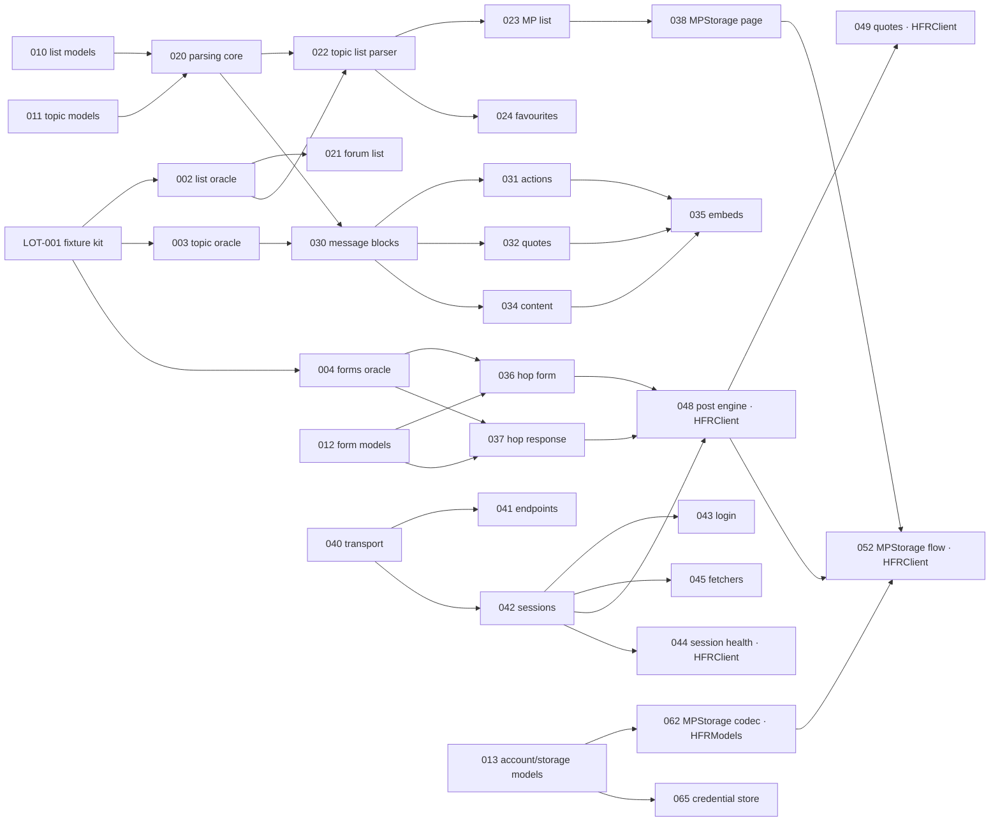

# Phase 1 — Legacy engine audit (LOT-000)

Audit of the legacy app's engine to plan its migration into `HFRKit`.
Legacy reference: <https://github.com/francoisgn/hfrnow> at commit `2440d79`. Audit by five parallel agents (Sonnet), synthesis by Opus, independent review by Fable ([REVIEW-fable.md](REVIEW-fable.md), resolved in the same PR).

| Report | Area |
|---|---|
| [A — Network & sessions](A-network-sessions.md) | Loader workers, login, accounts, cookies, search services, ASIHTTPRequest |
| [B — List parsing & models](B-list-parsing-models.md) | Forum/topic/MP/favourites parsers, data models, polls |
| [C — Message parsing](C-message-parsing.md) | Topic page parsing, content rewriting, WKWebView rendering |
| [D — Posting](D-posting.md) | Reply, quote, edit, delete, new topic, MP, alerts, AQ, flags, MPStorage, smileys, rehost |
| [E — Storage & vendors](E-storage-vendors.md) | UserDefaults, files, Keychain, data migration, vendor inventory |

Every fact in the reports cites `file:line` in the legacy repo. The reports predate [ADR 0008](../adr/0008-hfrclient-orchestration-module.md): where they assign a multi-step flow to `HFRNetwork`, [LOTS.md](../LOTS.md) is authoritative and places it in `HFRClient`. **No real HFR page exists in the legacy repo**: every statement about the HTML structure is read from code and marked *unverified* until Phase 2 captures fixtures.

## Results

- [docs/LOTS.md](../LOTS.md): 53 lots after LOT-000 (4 Phase 2 tooling, 48 engine, 1 gate), merged from ~66 overlapping proposals, with dependencies, difficulty and model routing. 16 lots (✱) need no fixtures to start.
- [docs/HFR-PROTOCOL.md](../HFR-PROTOCOL.md): consolidated protocol reference (endpoints, write flows, cookies, tokens, encoding).
- [ADR 0008](../adr/0008-hfrclient-orchestration-module.md) (accepted): new `HFRClient` module for multi-step flows. [ADR 0006](../adr/0006-content-normalization-in-parsing.md) and [ADR 0007](../adr/0007-third-party-api-keys.md) (accepted).

## Key findings

### What the legacy engine really is
- **Live code is smaller than it looks.** The 3,371-line `MessagesTableViewController.m` is not compiled into HFRswift; its logic was copied into the ObjC workers and renderer classes (C §1). Only `Catcounter` among the models is legacy-only (B §1).
- **The Swift app reaches ObjC through reflection** (`NSClassFromString` + `unsafeBitCast`), with no compile-time checking (A §2, B §1).
- **Parsers have side effects**: they write `hash_check`, the MP badge and `UserDefaults`, and apply blacklist/whitelist policy and avatar downloads while parsing (B §3, C §3). The new parsers are pure; policy moves app-side (Phase 4 backlog).
- **One shape for almost every write**: GET a page with `<form name="hop">`, copy its fields, override a few, POST to its action, classify the `.hop` response (D §2). One engine (LOT-048) covers reply, edit, delete, new topic and MP.
- **Bookmarks, synced blacklist and MP flags live in a private message** used as a JSON database, read-modify-written without conflict protection (D §2.10, E §2).

### Fragility to fix by design
- Positional DOM access and exact/substring class matching crash on unexpected markup (B §4).
- HTML rewriting by regex over libxml2's serialized output (C §4) → DOM-level rewriting with SwiftSoup (ADR 0006).
- No HTTP status check in workers; a maintenance page or login wall becomes an empty list (A §3.4, B §4) → typed errors.
- Global session state: one shared cookie jar wiped and refilled on every account switch, one global `hash_check` (A §4) → per-account isolated sessions (LOT-042).

### Visible bugs (not to reproduce; each becomes a documented intentional difference)
YouTube start-time hour offset (C) · multi-quote cookie matches post ids by substring (C) · private topics treated as public in filtered mode (C) · attribute values not entity-decoded in forms (D) · emoji no longer stripped before posting (D) · accented characters not percent-encoded in global search (A) · login clears cookies before validating credentials (A) · smiley search decodes Latin-1 first (A) · `BlackList` can overwrite its file with an empty list (E) · "last access" never persisted (E) · ~1,000 duplicated lines in `ReplyService.swift` (D's estimate, not measured).

### Security findings in the legacy app
- **Hard-coded API keys** (Giphy, image rehost) in the Swift sources. Values deliberately not copied here. Recommendation: rotate them; the new app injects keys from configuration (ADR 0007).
- `adv_ssl` setting disables TLS certificate validation for all ASIHTTPRequest traffic (A §6) — not carried over.
- Accounts serialized with `NSKeyedArchiver` (non-secure coding) in the Keychain (A §4.3, E §2). Passwords are never stored (good).
- AQ sends the user's pseudo and post data to a third-party service with no authentication (D §2.7) — product decision (Q-4).

### Vendors
HFRswift still links ASIHTTPRequest, HTMLParser, RegexKitLite, Reachability, SimpleKeychain and the Giphy SDK (+ libiconv, libicucore). Each maps to the lot that removes it in E §6; none is carried over except SwiftSoup (already approved).

## Dependency graph

Critical path (longest chain): **001 → 002 → 022 → 023 → 038 → 052**. Highest-risk chain for reading topics: **003 → 030 → 034**.

## Recommended start (parallel tracks)

1. **Phase 2 now** — LOT-001 on the maintainer's Mac: fixtures unblock every parser and the write engine.
2. **Fixtures-free lots in parallel** — models (010–014), parsing core (020), transport/endpoints/sessions/fetchers (040–042, 045, designed with the `HFRClient` contract), storage (060–063, 065, 066).
3. **Then, once fixtures exist** — the critical path 002 → 022 → 023 → 038 → 052, the reading chain 003 → 030 → 034 (Fable), and 004 → 036/037 → 048 (Opus).

## Decisions needed

Decisions recorded on 2026-10-24 are marked **Decided**.

| Id | Question | Blocks | Answer |
|---|---|---|---|
| ADR 0006 | Where does DOM-level content rewriting live, given SwiftSoup is confined to `HFRParsing`? | LOT-034 | **Decided** (ADR accepted): in `HFRParsing`, display-independent output (normalized HTML + typed lists), sanitization contract |
| ADR 0007 | How are third-party API keys injected; keep Giphy? | LOT-056, Giphy | **Decided** (ADR accepted): build configuration + CI secret, never committed; legacy key values reused for now, replaceable later; Giphy decision deferred to Phase 4 |
| Q-1 | Is SwiftHFR published as an update of the existing App Store app (same bundle id `hfrplus.red.super`, same developer team)? Only then can it import data the old app kept on the device (accounts, local lists, settings, drafts, smiley favourites, layout). MPStorage data lives on the forum and needs no import. | LOT-067 | **Decided**: no import — a new app does not take over another app's data. LOT-067 dropped |
| Q-2 | Server charset per endpoint (UTF-8 vs ISO-8859-1) | LOT-040 decoding defaults | Settle with Phase 2 fixtures (raw bytes + headers) |
| Q-3 | Emoji policy when posting (strip like legacy, keep, or encode) | LOT-048 | Test on a real post in Phase 2, then decide |
| Q-4 | Keep the AQ integration? `aq.super-h.fr` is a community server outside HFR; the app sends it the user's pseudo, topic and post data, unauthenticated. | LOT-055 | **Decided**: keep, with a first-use notice. Third-party services get an inventory and disclosure policy (LOT-071) |
| Q-5 | Offline reading in scope? | LOT-068 | **Decided**: in scope (new LOT-068) |
| Q-6 | MPStorage merge semantics across clients (other HFR+ clients write the same document) | LOT-062, LOT-052 | Conflict-aware merge, wire-compatible; confirm with other clients' authors if reachable |
| Q-7 | App Review workarounds kept by the legacy app to pass Apple's review: Apple category hidden when logged out, search word substitution (e.g. "jailbreak"), AQ feed hides category 25 except for the `applereview` reviewer account — keep or drop? | 021, 046, 055 | Search words: **Decided** — keep the list, refuse the search with a warning (no silent substitution). Apple category (cat 25): **Decided** — same policy as legacy, hidden when logged out and for the App Review account, in the forum list and the AQ feed; the review account name is configuration (default `applereview`) |
| Q-8 | Multi-account posting: post as the selected account (legacy ObjC) or always the main account (legacy Swift)? | 048 | **Decided**: as the selected account |
| Q-9 | Keychain accessibility class for accounts (e.g. after first unlock, this device only) | 065 | After-first-unlock, this-device-only (background MP check needs it) |
| Q-10 | Hard-coded third-party addresses (`marc@hardware.fr` alert fallback, account-deletion mail recipient) | Phase 4 | Keep out of source; decide per feature |
| Q-11 | Keep the "reprise" block, topic flag state and MP badge read from topic pages? | 033 | Decide in the LOT-033 spec with fixtures |

Each report also lists area-specific open questions (A §9, B §7, C §9, D §10, E §9).
